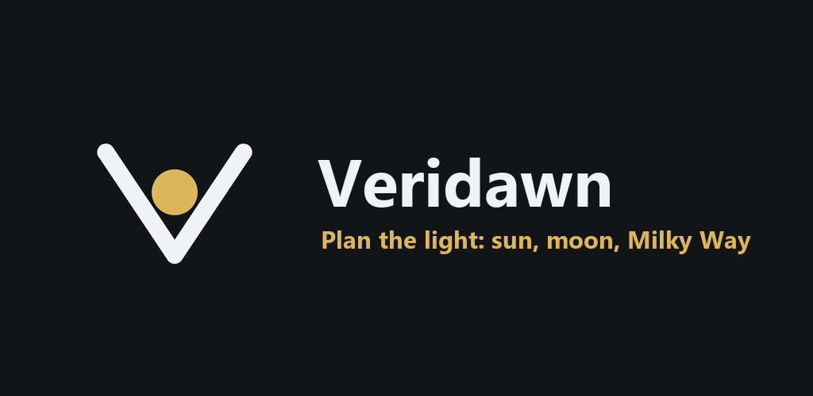
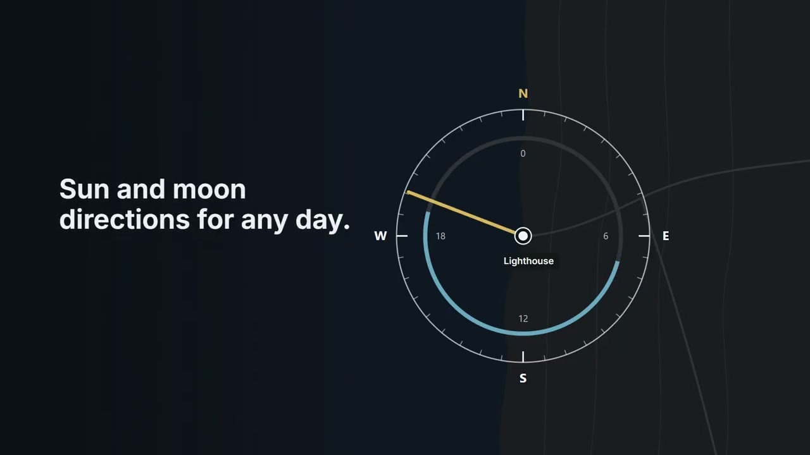

  

  <strong>Know where the light will be, before you leave home.</strong> 
  A free Android app for planning photos around the sun, the moon and the Milky Way.

   
  <a href="https://www.youtube.com/watch?v=sLHSqeIcKg0"><strong>▶ Watch the video</strong></a>

---

## See the shot before it happens

Stand where you'll shoot and take a photo: Veridawn remembers where the camera pointed. Then drag through the day, or hold the time bar to move through the year, and watch the sun and the moon cross your photo, behind the real horizon of hills and buildings.

## Plan

- **Map:** the sun and moon directions for any day, with a compass ring and a 24-hour dial
- **Light times:** golden hour, blue hour and twilight, with sunrise and sunset behind the terrain
- **Find:** the dates the sun or the moon lines up with a peak, a tower or a lighthouse
- **Milky Way:** the best nights to go out
- **Reminders:** an alert before a plan, and a home-screen widget with the next good light

## Shoot

- **Live camera:** the sun's path drawn over the view, with a framing grid and a target that shows where the sun will be
- **Exact direction:** tap the sun in a photo to line everything up

## Kit

Depth of field, hyperfocal distance, exposure, star trails, time-lapse, meteor showers and more. Each tool gives you the answer first.

## Private by design

No account, no ads, no analytics. Your photos, scenes and plans stay on your phone. The [privacy policy](https://ficcc.github.io/veridawn/privacy.html) lists everything that leaves it.

## Get Veridawn

Veridawn is in closed testing on Google Play, and the public release is on its way. To try it early, email [veridawn.app@gmail.com](mailto:veridawn.app@gmail.com).

Veridawn is free and made by one person. If it helps you catch the light, you can leave a tip in the app or tell a friend.

---

  <a href="https://ficcc.github.io/veridawn/">Website</a> ·
  <a href="https://ficcc.github.io/veridawn/privacy.html">Privacy</a> ·
  <a href="https://ficcc.github.io/veridawn/terms.html">Terms</a> ·
  <a href="mailto:veridawn.app@gmail.com">Feedback</a>

This repository hosts the Veridawn website. Notes on maintaining it are in <a href="SITE.md">SITE.md</a>.

